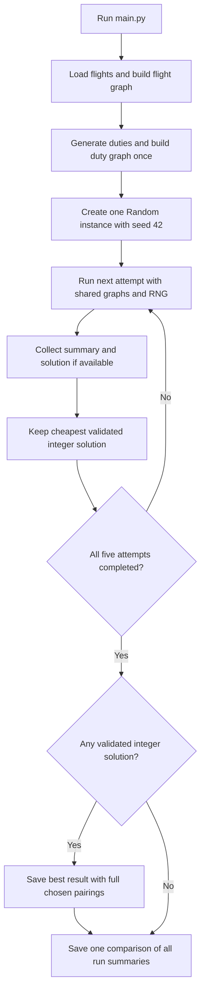
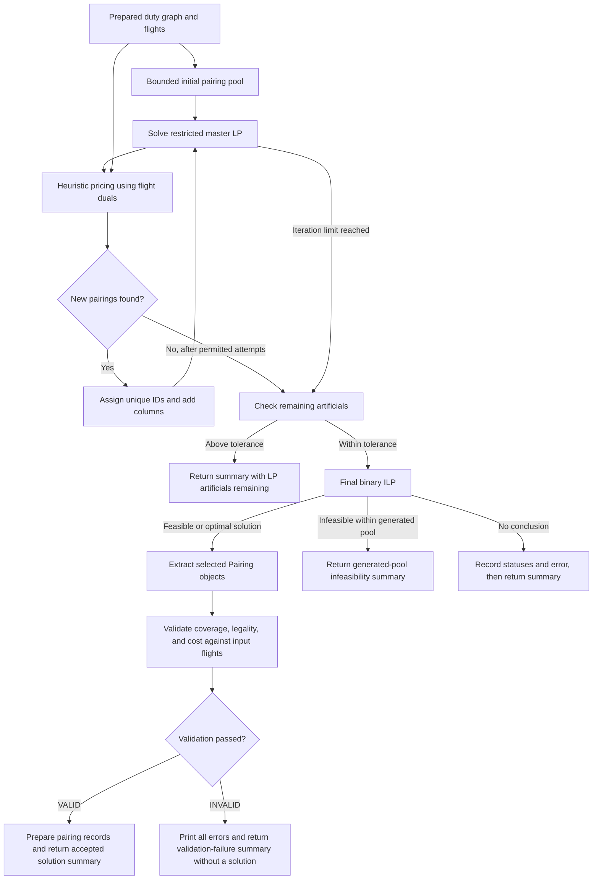

# Project Planning and Flow - Airline Crew Pairing

Updated October 13, 2026, to include independent post-ILP solution validation.
Restored from the project's earlier flow document and revised against the
current code. See [README.md](README.md) for installation and run instructions.

## 1. Project Goal and Pipeline

Given scheduled flights and crew bases, generate duties and pairings that obey
the configured rules, then select a low-cost set of pairings. Required flights
must be covered exactly once; optional padding flights may be covered at most
once. A pairing starts and finishes at the same crew base.

The root runner prepares the graphs once, then performs five attempts by
default using one shared `random.Random(42)` instance. Each attempt generates
a fresh bounded initial pairing pool, adds promising pairings through heuristic
pricing and a restricted master LP, and solves a final binary ILP over the
resulting columns using MOSEK Fusion. Every attempt that produces an ILP solution
validates its selected pairings before accepting or serializing them. Results
return to the root runner in memory. It saves the cheapest validated integer
solution and one comparison of all attempts.

The batch flow is:



Each attempt follows this optimization flow:



Pricing is bounded and heuristic. An empty pricing result does not prove that
all possible improving pairings have been exhausted. An optimal final ILP
solution is optimal over its generated columns; the pipeline does not certify
global optimality over every possible pairing. The ILP also accepts a feasible
solution if MOSEK reports one without an optimal status.

## 2. Load Data and Build the Flight Graph

Implementation: [crew_pairing/flights_graph.py](crew_pairing/flights_graph.py).
Input paths and legality limits are in
[crew_pairing/config.py](crew_pairing/config.py); data-directory locations are in
[crew_pairing/data_paths.py](crew_pairing/data_paths.py).

The current local configuration uses these instance 1 inputs:

- `data/generated/instance1_week_3_with_start_end_padding.csv`: 428 flights
  departing January 12-24, 2000, including 227 required flights departing
  January 15-21 and 201 optional padding flights.
- `data/inputs/instance1_listOfBases.csv`: airport codes and crew-base status.

To switch datasets, update both `FLIGHTS_FILE_PATH` and `HUBS_FILE_PATH` in
`crew_pairing/config.py` and align the padding dates with the chosen schedule.

The flight fields are `leg_nb`, `airport_dep`, `date_dep`, `hour_dep`,
`airport_arr`, `date_arr`, and `hour_arr`. Base fields are `airport` and `status`.
Flight IDs must be unique strings, and arrival must be strictly after departure;
the loader rejects violations. All timestamps must use a consistent time basis.
Airports not marked as crew bases have non-base status.

`Airport` stores `port_name` and `is_crew_base`. `Flight` stores its ID, origin,
destination, departure datetime, and arrival datetime.

The graph is `Dict[Flight, List[Flight]]`. An edge `F1 -> F2` exists when the
arrival airport of `F1` matches the departure airport of `F2`, and the wait is
within the configured connection interval. Defaults are 30 minutes to 8 hours,
inclusive. These edges describe connections inside a duty.

### Required flights and padding

[crew_pairing/padding_flights.py](crew_pairing/padding_flights.py) classifies
flights by departure date. The current inclusive padding intervals are
January 12-14 and January 22-24, 2000. Flights outside those intervals are
required. Keep these dates aligned with the active input file when changing
datasets.

Padding lets a pairing begin before or finish after the required week. Padding
flights participate in graphs, pairings, and costs, but their coverage is optional.

## 3. Generate Duties

Implementation: [crew_pairing/duties.py](crew_pairing/duties.py),
`generate_duties(graph) -> Dict[str, Duty]`.

A duty is an ordered sequence of connected flights. DFS starts from every flight
and saves each nonempty legal prefix as a separate duty before extending it.
For example, `[F1]`, `[F1, F2]`, and `[F1, F2, F3]` are separate duties if all
three meet the limits. Duty generation has no configured DFS-state budget.

Current duty limits are:

| Rule | Default |
| --- | --- |
| Maximum elapsed duty time | 12 hours |
| Maximum actual flight time | 8 hours |
| Maximum flights per duty | 5 |

`Duty` stores its ID, a tuple of flights, `total_time`, `flight_time`, and
`sitting_time`. Airports and start/end times are derived from its flights.

```text
flight_time  = sum of scheduled flight durations
sitting_time = sum of waits between flights inside the duty
total_time   = flight_time + sitting_time
```

A single-flight duty has zero sitting time. A duty may start or end at any
airport; returning to a crew base is a pairing-level rule.

## 4. Build the Duty Graph

Implementation: [crew_pairing/duty_graph.py](crew_pairing/duty_graph.py),
`build_duty_graph(duties.values()) -> Dict[Duty, List[Duty]]`.

An edge `D1 -> D2` exists when `D1` ends at the airport where `D2` starts,
`D2` starts after `D1` ends, and the intervening rest is within the configured
interval. The default interval is 10 to 48 hours, inclusive.

The graph supplies airport continuity and rest legality for pairing searches.
Both graph builders currently compare pairs of nodes; graph preparation can
therefore be expensive as the flight and duty collections grow.

## 5. Pairing Representation and Initial Pool

The model and shared construction helpers are in
[crew_pairing/pairings.py](crew_pairing/pairings.py). The initial search is in
[column_generation/initial_pool.py](column_generation/initial_pool.py).

A pairing is an ordered tuple of duties. Searches start only at duties departing
from a crew base and save a pairing only when it returns to that same base.
Ending at a different crew base is insufficient. Search may continue after a
return so that both shorter and longer closed pairings can be considered.

The current limits are at most 5 duties and 5 days of elapsed pairing time,
including rest. The searches avoid repeating a duty in the current path.

`Pairing` stores its ID, duties, `total_time`, `flight_time`, `sitting_time`, and
`rest`. Airports and start/end times are derived from its duties.

```text
flight_time  = sum of duty flight times
sitting_time = sum of duty sitting times
rest         = sum(duty[i+1].start_time - duty[i].end_time)
total_time   = flight_time + sitting_time + rest
```

A one-duty pairing has zero rest. `Duty` and `Pairing` are frozen dataclasses;
their constructors validate nonempty contents and consistent, nonnegative time
components. Graph construction and searches enforce the connection, base, and
duration rules.

`generate_initial_pairings` returns `(pairings, existing_pairing_signature)`.
The second object is a set of ordered duty-ID tuples used for duplicate detection.
The initial DFS saves a unique closed pairing when it contributes to a required
flight whose initial-pool coverage target has not yet been reached.

The target is 10 candidate pairings per required flight, rather than 10 selected
pairings in the final solution. It is not a strict cap: a saved pairing can also
contain flights already above that target. Padding does not count toward it.

The search stops when all targets are met or a budget is exhausted. Defaults
are 3,000 saved pairings, 1,000,000 DFS states overall, 1,000 states per starting
duty, and 50 saved pairings per starting duty. Incomplete initial coverage is
allowed; the LP uses artificials while pricing tries to supply missing columns.

## 6. Cost and Coverage Index

Implementation: [crew_pairing/pairing_cost.py](crew_pairing/pairing_cost.py) and
`_coverage_index` in
[column_generation/master_lp.py](column_generation/master_lp.py).

The default objective measures non-flight time in hours:

```text
cost(pairing) = (pairing.rest + pairing.sitting_time).total_seconds() / 3600
```

Pairings store the time components rather than a fixed cost. LP, pricing, ILP,
validation, and export functions accept a replaceable `cost_function`. Use the same function
through those stages when introducing another objective. Pricing's successor
ranking remains based on the default rest-and-sitting model; complete pairing
acceptance uses the supplied cost function.

The current solver uses a coverage index rather than a dense pairing-flight
matrix. It produces pairing IDs, their costs in the same order, and a list of
covering pairing indices for every flight. Both master models use this helper.

## 7. Restricted Master LP

Implementation: [column_generation/master_lp.py](column_generation/master_lp.py),
`solve_master_lp(pairings, flights, cost_function) -> MasterLpResult`.

Each current pairing has a continuous variable `0 <= x[p] <= 1`. Each required
flight has an artificial variable `0 <= a[f] <= 1` to keep the initial restricted
model feasible even when real columns cannot provide complete coverage.

```text
Required flight f: sum(x[p] for p covering f) + a[f] = 1
Padding flight f:  sum(x[p] for p covering f) <= 1

minimize sum(cost[p] * x[p]) + ARTIFICIAL_COST * sum(a[f])
```

`ARTIFICIAL_COST` is 1,000,000. `MasterLpResult` contains flight duals, the LP
objective, artificial values for required flights, and MOSEK problem, primal,
and dual solution statuses. This objective includes artificial penalties while
they remain positive. The run summary records those statuses, the objective,
and the count of artificial variables strictly above `ARTIFICIAL_TOLERANCE`.
Each new LP solve resets its summary fields so a failed solve does not report
values from the previous iteration. CG still requires the existing optimal
primal and dual solution access; an unresolved status and its original exception
are retained in the summary.

The LP solution may be fractional. Removing artificials establishes coverage
using the generated columns at the LP level; it does not guarantee that a
binary solution exists over those columns.

## 8. Pricing and the Column-Generation Loop

Implementation: [column_generation/pairing_pricing.py](column_generation/pairing_pricing.py)
and [column_generation/column_generation.py](column_generation/column_generation.py).

Pricing searches the duty graph for unique closed pairings with negative reduced
cost under the current flight duals:

```text
reduced_cost(p) = cost(p) - sum(dual[f] for flights in p)
Accept only if reduced_cost(p) < -1e-6.
```

Successors are ranked by added rest and sitting hours minus successor flight
duals. Rankings are cached within a pricing call because its duals remain fixed.
Path-dependent feasibility checks run before taking the best 20 successors;
these successors and the starting duties are shuffled to vary exploration.

Default pricing budgets per call are:

| Budget | Default |
| --- | --- |
| Total DFS states | 500,000 |
| DFS states per starting duty | 500 |
| New negative-cost pairings per starting duty | 100 |
| Total new pairings | 2,000 |

Accepted signatures are added to the shared set in place. Pricing returns only
the new pairings, and the loop assigns globally unique IDs when adding them to
the accumulated columns. This keeps the dictionary keys and object IDs aligned.

`run_column_generation` uses the supplied shared RNG (or creates a seeded RNG
for a standalone call) and reuses it across pricing
calls and retries. Each call receives fresh search budgets and rankings while
continuing the same random sequence.

The loop performs these steps:

1. Generate the initial pool and shared signature set.
2. Solve the restricted master LP.
3. Price using its flight duals. If artificials exceed `1e-6`, allow up to five
   attempts, stopping retries as soon as one finds new pairings. Otherwise,
   use one attempt.
4. Add new columns and solve the LP again.
5. Repeat until no permitted attempt finds new pairings, or 100 iterations
   have been reached.

The return value is `(pairings, master_result)`. The loop owns the signature set
internally and does not solve the final ILP.

## 9. Final Binary ILP

Implementation: [column_generation/master_ilp.py](column_generation/master_ilp.py),
`solve_ilp(pairings, flights, cost_function)`.

The runner first checks the last LP's artificial values. If any exceed `1e-6`,
it prints the affected required flight IDs, artificial values, and duals, and
stops before the binary solve.

The final ILP has no artificial variables:

```text
x[p] in {0, 1}
Required flight f: sum(x[p] for p covering f) = 1
Padding flight f:  sum(x[p] for p covering f) <= 1
minimize sum(cost[p] * x[p])
```

It returns `(solution, total_cost)`, where `solution` maps pairing IDs to numeric
selection values and `total_cost` is MOSEK's actual primal objective, read with
`Model.primalObjValue()`. It is not a separate sum of selected pairing costs;
the validator independently recalculates those costs for comparison. The return
format remains the same two-value tuple. Values above
`SELECTION_THRESHOLD = 0.5` count as selected.
If MOSEK reports primal infeasibility, it prints a message and returns `None`.
Other solution statuses without a feasible or optimal primal solution raise an
error. Infeasibility of this restricted ILP does not establish infeasibility
over all possible legal pairings.

## 10. Independent Post-ILP Solution Validation

Implementation: [crew_pairing/solution_validator.py](crew_pairing/solution_validator.py),
`validate_solution(selected_pairings, flights, total_cost, cost_function=current_pairing_cost)`.

In [column_generation/main_column_generation.py](column_generation/main_column_generation.py),
validation runs immediately after `chosen = selected_pairings(pairings, solution)`.
It runs for every attempt that produces an ILP solution, including UI-started
runs, before creating `IntegerSolutionSummary`, serializing selected pairings,
or marking the attempt successful. If an attempt stops before producing an ILP
solution, there is no solution to validate and `ilp.validation` remains `null`.

The validator inspects only selected pairings. It uses the original flight data
as the source of truth and checks:

- Every required flight is covered exactly once, and every padding flight at
  most once, using the existing padding classification.
- Flight IDs do not repeat within a pairing, including across duties, or across
  selected pairings. Every referenced ID exists, and its flight data matches
  the original input.
- Pairings start at a crew base, return to the same base, contain duties, and
  satisfy the configured duty-count and elapsed pairing-duration limits.
- Duties contain flights with positive durations in chronological order,
  connect at the same airport, and satisfy the configured minimum/maximum
  connection times, elapsed duty time, actual flight time, and flight count.
- Consecutive duties connect at the same airport and satisfy the configured
  minimum rest and maximum layover limits.
- Duty and pairing time components can be reconstructed consistently from the
  original flights. Temporary copies are passed to the existing cost function;
  calculated costs and the solver objective must be finite. The independently
  recalculated total must match the objective within `1e-6` absolute or `1e-9`
  relative tolerance.

All scheduling limits come from `crew_pairing/config.py`. Validation does not
use MOSEK, run optimization, or modify selected pairings or input flights. It
collects all detectable failures in `ValidationResult(is_valid, errors)` and
stores that object in `summary.ilp.validation`.

For a valid solution, the runner prints `Solution validation: VALID`, prepares
the normal solution payload, sets `outcome = "integer_solution_found"`, and
continues with the existing cost and selected-pairing output. This attempt is
eligible for Best Run selection.

For an invalid solution, the runner prints `Solution validation: INVALID` and
every error, sets `outcome = "solution_validation_failed"`, leaves
`integer_solution = None`, and returns before preparing pairing records. It
cannot become Best Run. The batch retains its report and continues later attempts.
Validation checks correctness under the configured rules; it does not certify
global optimality or add scheduling rules.

## 11. Runner and Result Export

The entry point is [main.py](main.py), with five attempts sharing one
`random.Random(42)` instance by default.
Run from the repository root with the dependencies and a valid MOSEK license:

```powershell
python main.py
```

The root runner loads data, builds the flight graph, generates duties, and
builds the duty graph once for the batch. For each attempt it passes the prepared
duty graph, flights, the shared RNG, and a fresh run summary to
[column_generation/main_column_generation.py](column_generation/main_column_generation.py),
which handles CG, the artificial-coverage check, final ILP, independent validation,
and accepted selected-pairing records. `RunSummary` is a dataclass; a fresh
`RunSummary()` object holds each attempt's statuses, timings, validation report,
and accepted solution when available. Each attempt returns its result in memory.
The root runner keeps the cheapest validated integer solution and saves its
full combined result at the end, plus one compact comparison of all attempts.
The RNG is seeded once and
continues its stream across attempts; summaries record the shared seed and
one-based batch run index. Replaying a batch with the same seed and run order
reproduces its random sequence. A later attempt needs the preceding RNG state;
reseeding alone does not replay that attempt. Initial pool generation is
deterministic; pricing consumes the shared random sequence.
Attempt errors keep their printed traceback and are collected without stopping
later attempts. Shared setup errors stop the batch, record the error in the
comparison with zero completed attempts, and propagate the exception.
The previous module command forwards to the root runner.
Progress messages are controlled by `ILP_PROGRESS`; set it to `0` to silence them.

[column_generation/results_to_json.py](column_generation/results_to_json.py)
maps selected IDs back to `Pairing` objects and serializes the selected pairing
records after validation succeeds. The root runner writes
`results/runs/best_<batch_id>.json` for the cheapest validated solution,
combining its summary and `integer_solution.pairings`, and
`results/runs/comparison_<batch_id>.json` for all compact run summaries.
Selection compares final integer cost, measured in rest plus sitting hours;
equal costs keep the first validated run. If no accepted solution is found,
only the comparison is written. No per-attempt files or separate selected-pairing
export are written by this runner. The comparison excludes full pairing records
and includes the winning run ID, cost, and full-result path, or `null`.
Batch and run IDs come from `uuid.uuid4().hex`, independently of the seed.
Results are never overwritten. The output directory is created automatically
and ignored by Git. File-writing errors propagate; if an earlier batch error
already exists, a comparison-writing failure is printed while preserving that error.

Run and export timestamps use local `DD/MM/YY HH:MM`, without a timezone.
The comparison records shared graph preparation time once at batch level.
Each run records `build_graphs: 0`, plus separate `initial_pool`,
`column_generation`, `final_ilp`, and `total` runtimes in seconds. CG time
includes the first LP, pricing and its retries, and all LP re-solves.
Run total includes validation and preparing the pairing records and excludes
shared setup and JSON writing. Batch total includes setup, attempts, and saving the best result;
it is measured before writing the comparison. Interrupted phases retain their
elapsed time and unstarted phases are `null`.
The summary includes completed CG iterations, pairing-pool size, CG termination
reason, solver statuses, LP objective and artificial count, ILP attempted/skipped
reason, independent validation result, integer cost and count when available,
outcome, and error details. The existing `final_ilp` timing measures the solver
call; validation occurs afterward and is included in run total time.
The initial LP is not an iteration; a completed empty-pricing pass counts as
one iteration, and interrupted iterations do not. Each chosen pairing
includes its ID, cost, airports, times, duration components, and nested duties
and flights. Pairings are sorted by start time and then ID. Flight and pairing
timestamps use `YYYY-MM-DD HH:MM`; durations are Python `timedelta` strings.

The runner also prints column count, LP objective, validation status and any
validation errors, accepted solution dimensions, total cost, selected pairing
count, and the output path. The main result is JSON;
the separate pricing benchmark writes CSV files.

Runs without a solution remain in the single comparison file, distinguishing
remaining LP artificials, integer infeasibility within the generated pool,
solver termination without a conclusion, validation failures, and execution errors.
The corresponding outcome codes are `lp_artificials_remaining`,
`generated_pool_integer_infeasible`, `solver_no_conclusion`,
`solution_validation_failed`, and `execution_error`.
Successful runs use `integer_solution_found`. None of the first three failure
outcomes proves that the full problem is infeasible. Error records contain the
exception type, message, and traceback alongside any available measurements.

### Validation fields in JSON

Both the winning run's full JSON and each compact run record in the comparison
include `ilp.validation`. The existing dataclass serialization converts a
completed validation report into this object:

```json
{
  "ilp": {
    "validation": {
      "is_valid": true,
      "errors": []
    }
  }
}
```

Rejected attempts have `is_valid: false` and the collected error messages, with
`outcome: "solution_validation_failed"` and `integer_solution: null`. Attempts
that never reached validation have `validation: null`. These are additive fields
in newly generated reports; existing JSON files are not rewritten. No separate
validation output file is created.

### Existing UI behavior

The local UI calls the same batch runner, so its attempts pass through the same
validation gate. It continues displaying the accepted Best Run's cost, pairing
count, timeline, base filter, and duty/flight details. The downloaded solution
JSON includes the validation report, while the display reads the existing
solution fields. Validation introduces no new UI fields or layout changes.

Detailed validation messages appear in the terminal and comparison JSON. If no
attempt is accepted, the UI shows its existing
`No run produced a feasible integer solution.` warning and displays no solution.

## 12. File Responsibilities

| File | Responsibility |
| --- | --- |
| [crew_pairing/config.py](crew_pairing/config.py) | Active inputs, legality limits, padding intervals |
| [crew_pairing/data_paths.py](crew_pairing/data_paths.py) | Repository-relative data locations |
| [crew_pairing/flights_graph.py](crew_pairing/flights_graph.py) | Airport/flight models, CSV validation, flight graph |
| [crew_pairing/duties.py](crew_pairing/duties.py) | Duty model and DFS generation |
| [crew_pairing/duty_graph.py](crew_pairing/duty_graph.py) | Connections between duties |
| [crew_pairing/pairings.py](crew_pairing/pairings.py) | Pairing model, construction, signatures |
| [crew_pairing/pairing_cost.py](crew_pairing/pairing_cost.py) | Default cost and transition scoring cost |
| [crew_pairing/padding_flights.py](crew_pairing/padding_flights.py) | Required/padding classification |
| [crew_pairing/solution_validator.py](crew_pairing/solution_validator.py) | Independent selected-solution coverage, legality, and objective checks |
| [column_generation/config.py](column_generation/config.py) | Search budgets, seed, solver tolerances, output path |
| [column_generation/initial_pool.py](column_generation/initial_pool.py) | Bounded initial pairing search |
| [column_generation/master_lp.py](column_generation/master_lp.py) | Coverage index, restricted LP, duals, artificials |
| [column_generation/pairing_pricing.py](column_generation/pairing_pricing.py) | Bounded search for negative reduced-cost pairings |
| [column_generation/column_generation.py](column_generation/column_generation.py) | LP/pricing loop and shared signatures |
| [column_generation/master_ilp.py](column_generation/master_ilp.py) | Final binary selection over generated columns |
| [column_generation/results_to_json.py](column_generation/results_to_json.py) | Run/batch summaries, timestamps, phase timing, compact comparison records, selected pairing serialization, and JSON files |
| [column_generation/main_column_generation.py](column_generation/main_column_generation.py) | CG, final ILP, validation before acceptance, and selected pairing records for prepared inputs |
| [main.py](main.py) | Shared graphs and RNG, repeated attempts, best selection, and comparison output |
| [run_progress.py](run_progress.py) | Progress messages and tickers |

## 13. Current Status and Further Work

The flight graph, duty DFS, duty graph, pairing model, initial pool, restricted
LP, pricing, column-generation loop, final ILP, independent solution validation,
and JSON export are implemented.
The previous standalone matrix-based solver path is no longer part of the
current pipeline. This document describes the rules currently encoded in the
project; airline-specific regulatory coverage requires separate validation.

The restored
[pricing configuration benchmark](experiments/pricing_configuration_benchmark/README.md)
compares search budgets using the current pricing implementation. Its historical
CSV results belong to the earlier implementation and dataset; new runs write
into separate run directories. It measures time to LP feasibility, while the
production loop can continue improving the objective after artificials vanish.
It does not automatically change production defaults.

Possible next steps are to measure runtime and solution quality across datasets,
improve graph preparation and search where profiling justifies it, and compare
heuristic pricing with an exact method if an optimality certificate is needed.
Run summaries and batch comparisons now retain successful and failed attempts.
The existing local UI displays the accepted best solution; detailed per-attempt
statuses and validation reports remain in the JSON comparison. Assigning
individual crew members to selected pairings would be a
separate crew-scheduling extension.

Each stage receives and returns explicit models or result objects. Keeping
graph construction, search, optimization, and export in their respective modules
allows their behavior to be inspected and changed independently.
